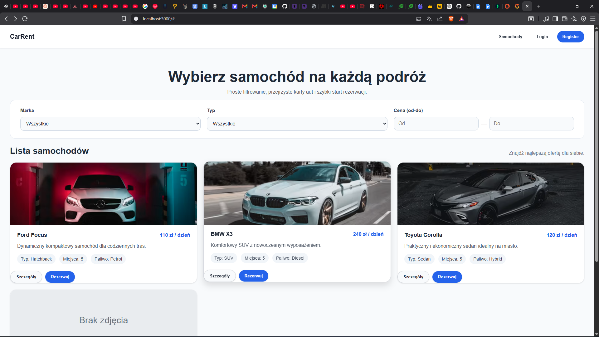
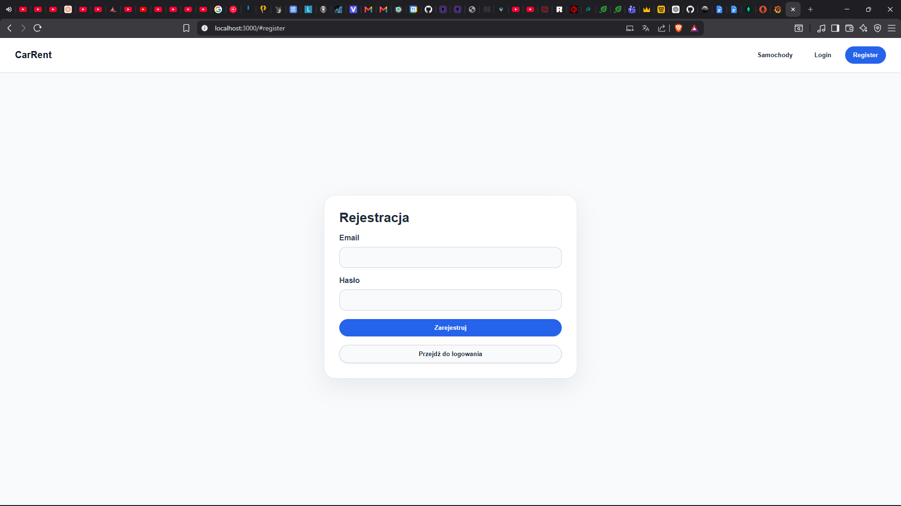
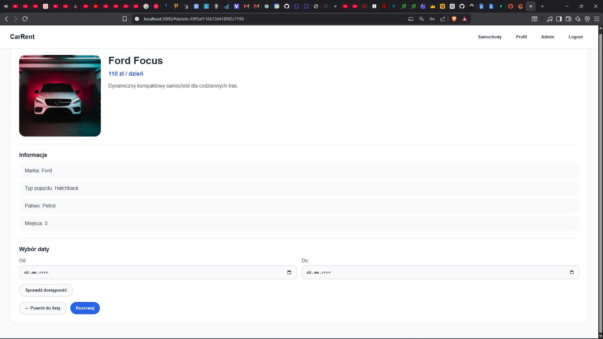
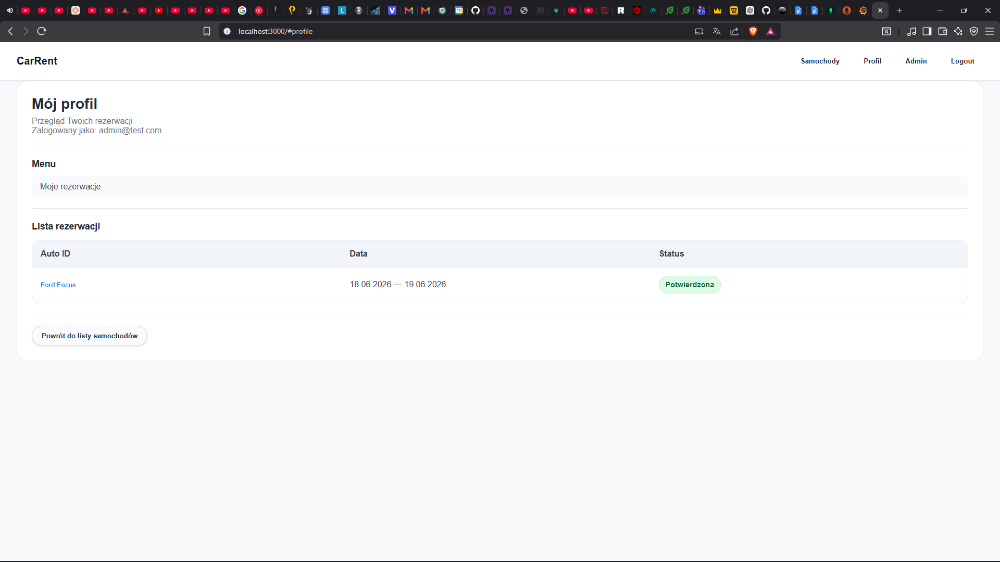
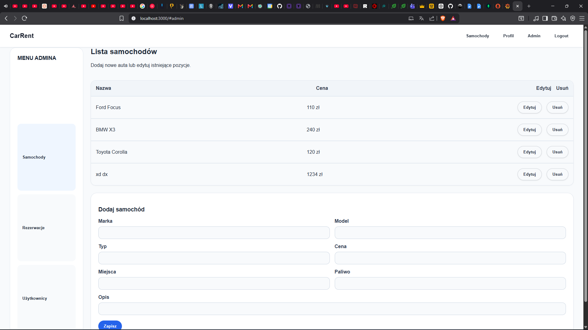
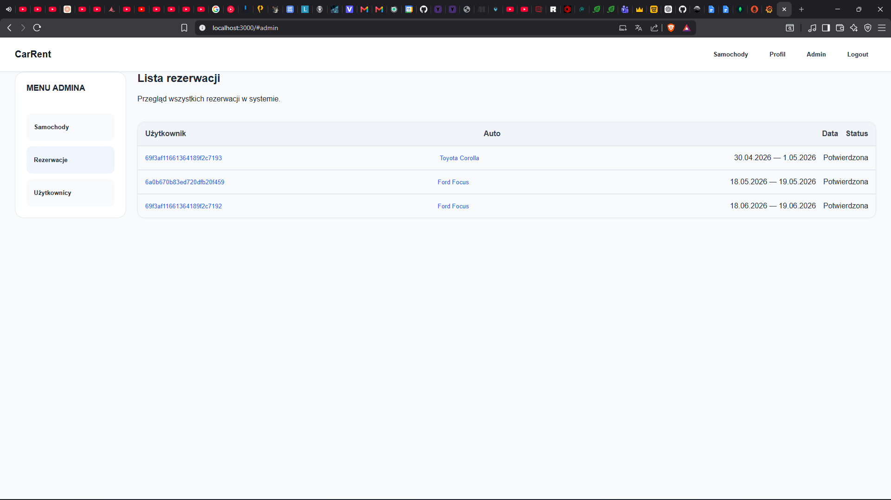
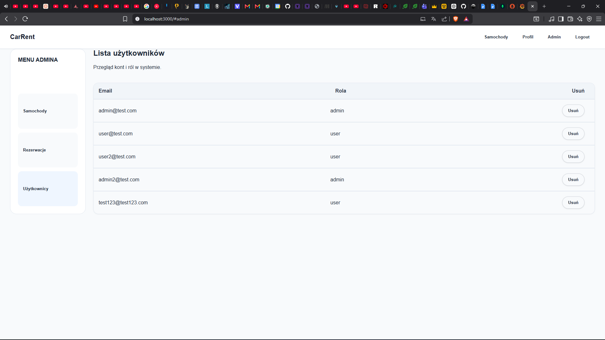

# System wypożyczania samochodów

## Opis projektu

System wypożyczania samochodów to pełnowymiarowa aplikacja internetowa umożliwiająca użytkownikom przeglądanie dostępnych pojazdów oraz dokonywanie ich rezerwacji online.  
Użytkownicy mogą tworzyć konto, logować się do systemu oraz zarządzać swoimi rezerwacjami.

System zawiera również panel administratora, który pozwala zarządzać flotą samochodów, rezerwacjami użytkowników oraz kontami użytkowników.

---

## Funkcjonalności

### Dla użytkowników:
- **Rejestracja i logowanie** - System autoryzacji użytkowników
- **Przeglądanie samochodów** - Lista dostępnych pojazdów z możliwością filtrowania po marce, typie i cenie
- **Szczegóły pojazdu** - Pełne informacje o samochodzie (marka, model, typ, paliwo, liczba miejsc, opis)
- **Sprawdzanie dostępności** - Weryfikacja dostępności pojazdu w wybranym terminie
- **Rezerwacja** - Dokonywanie rezerwacji z automatycznym obliczaniem ceny
- **Zarządzanie rezerwacjami** - Podgląd historii rezerwacji w profilu użytkownika
- **Statusy rezerwacji** - Śledzenie statusu rezerwacji (oczekująca, potwierdzona, zakończona)

### Dla administratorów:
- **Zarządzanie flotą** - Dodawanie, edycja i usuwanie samochodów
- **Zarządzanie rezerwacjami** - Podgląd wszystkich rezerwacji w systemie
- **Zarządzanie użytkownikami** - Podgląd i zarządzanie kontami użytkowników
- **Panel administracyjny** - Przyjazny interfejs do zarządzania systemem

### Ulepszenia UI/UX:
- **Animacje ładowania** - Spinner ładowania z płynnymi animacjami
- **Efekty przycisków** - Hover effects, cienie, transformacje i stany disabled
- **Stany formularzy** - Poprawione stany focus z podświetleniem i cieniami
- **Efekty kart** - Cienie, hover effects i animacje kart samochodów
- **Stany błędów i pustych stanów** - Lepsze wizualne informacje zwrotne
- **Responsywność** - Zoptymalizowany layout dla urządzeń mobilnych
- **Mikro-animacje** - Płynne przejścia i animacje elementów interfejsu
- **Tabele admina** - Poprawiony design z hover effects
- **Odznaki statusów** - Lepsze kodowanie kolorów i efekty hover

---

## Użyte technologie

Frontend:
- React.js
- CSS3 z animacjami i transitions

Backend:
- Node.js
- Express
- JWT (JSON Web Tokens) dla autoryzacji
- bcryptjs do haszowania haseł

Baza danych:
- MongoDB z Mongoose

---

## Instrukcja uruchomienia projektu

### Wymagania

Aby uruchomić projekt lokalnie należy mieć zainstalowane:

- Node.js (v14 lub nowszy)
- npm
- MongoDB (lokalnie lub chmura)

---

### 1. Sklonowanie repozytorium

```bash
git clone https://github.com/TWOJ_LOGIN/car-rental-system.git
cd car-rental-system
```

---

### 2. Uruchomienie backendu

```bash
cd backend
npm install
npm run dev
```

Backend będzie dostępny pod adresem:

```
http://localhost:5000
```

---

### 3. Uruchomienie frontendu

W nowym terminalu:

```bash
cd frontend
npm install
npm start
```

Frontend będzie dostępny pod adresem:

```
http://localhost:3000
```

---

## Instrukcja uruchomienia produkcyjnego

### Wymagania produkcyjne:

- Serwer z Node.js (v14 lub nowszy)
- MongoDB (Atlas lub własna instancja)
- Nginx lub inny reverse proxy (opcjonalnie)
- SSL certyfikat (HTTPS)
- Zmienne środowiskowe

### 1. Przygotowanie środowiska

Ustaw zmienne środowiskowe:

```bash
# Backend
MONGODB_URI=mongodb+srv://<username>:<password>@cluster.mongodb.net/car-rental
JWT_SECRET=your-super-secret-jwt-key
PORT=5000
NODE_ENV=production

# Frontend
REACT_APP_API_URL=https://your-domain.com/api
```

### 2. Budowanie frontendu

```bash
cd frontend
npm run build
```

Plik `build/` zawiera zoptymalizowaną wersję produkcyjną.

### 3. Uruchomienie backendu w produkcji

```bash
cd backend
npm install --production
npm start
```

Lub używając PM2 dla lepszej wydajności:

```bash
npm install -g pm2
pm2 start server.js --name car-rental-backend
pm2 save
pm2 startup
```

### 4. Konfiguracja Nginx (opcjonalnie)

```nginx
server {
    listen 80;
    server_name your-domain.com;

    location / {
        root /path/to/frontend/build;
        try_files $uri /index.html;
    }

    location /api {
        proxy_pass http://localhost:5000;
        proxy_http_version 1.1;
        proxy_set_header Upgrade $http_upgrade;
        proxy_set_header Connection 'upgrade';
        proxy_set_header Host $host;
        proxy_cache_bypass $http_upgrade;
    }
}
```

### 5. Konfiguracja HTTPS

Użyj Let's Encrypt lub innego dostawcy SSL certyfikatów.

---

## Znane ograniczenia

1. **Brak walidacji dat** - System nie sprawdza czy data rozpoczęcia jest wcześniejsza niż data zakończenia
2. **Brak walidacji dostępności** - Rezerwacje mogą się nakładać na ten sam samochód w tym samym terminiee
3. **Brak płatności** - System nie obsługuje płatności online
4. **Brak powiadomień** - Użytkownicy nie otrzymują powiadomień email o rezerwacjach
5. **Brak systemu ocen** - Brak możliwości oceny samochodów i rezerwacji
6. **Brak obsługi anulacji** - Rezerwacje nie mogą być anulowane przez użytkowników
7. **Brak historii** - Brak pełnej historii zmian w systemie
8. **Brak testów** - Projekt nie posiada automatycznych testów
9. **Brak dokumentacji API** - Dokumentacja API jest podstawowa
10. **Brak obsługi wielojęzycznej** - Aplikacja jest dostępna tylko w języku polskim

---

## Dokumentacja

Dokumentacja projektu znajduje się w katalogu `docs` w repozytorium:

```
docs/
├── api.md          - Dokumentacja API
├── ui.md           - Dokumentacja UI/UX
├── monitoring.md   - Dokumentacja monitorowania
├── topic_selection.md - Wybór tematu
├── Diagram ERD.png - Diagram bazy danych
└── UML.png         - Diagram UML
```

---

## Screenshoty

Główna Strona:

Rejestracja/Login:

Szczegóły/Rezerwacja

Profil:

Menu Admina - samochody:

Menu Admina - rezerwacje:

Menu Admina - użytkownicy:

---

## Autorzy

Daniel Kochański
Kacper Krzysztof